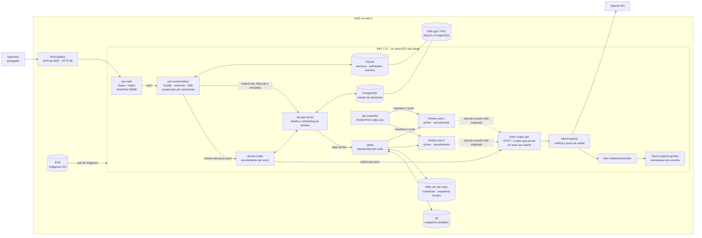
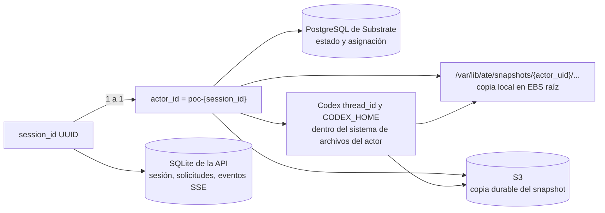
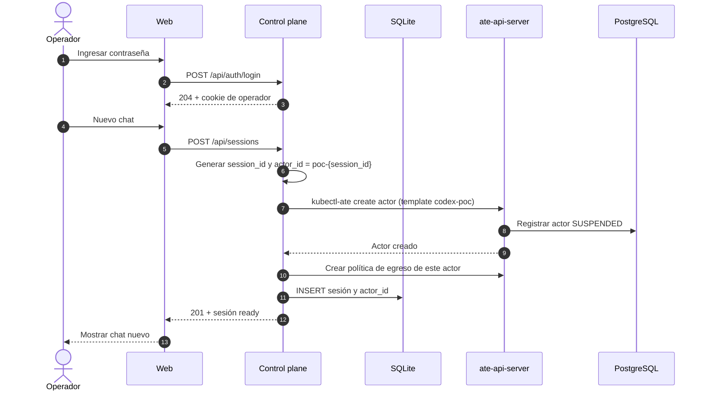
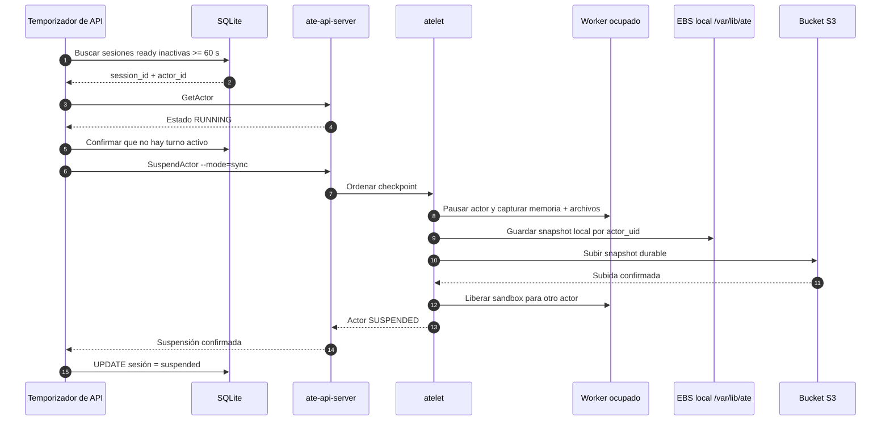
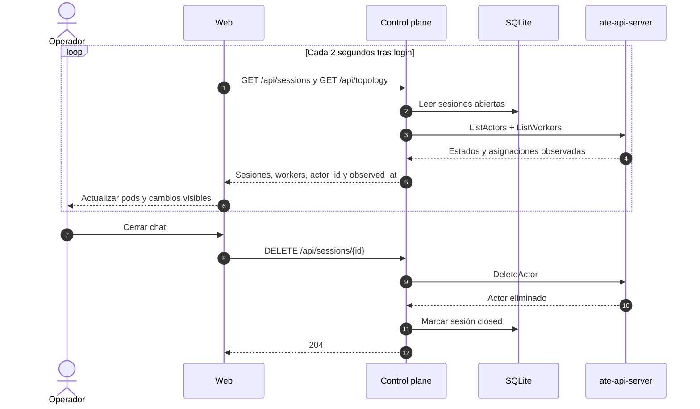
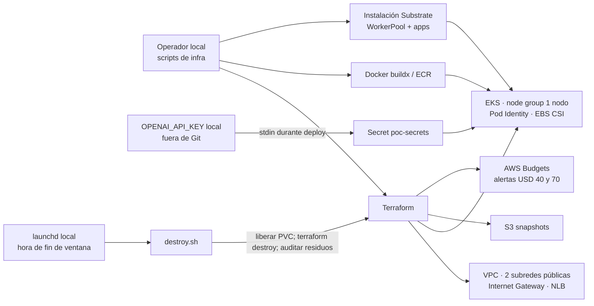

# Arquitectura de la PoC de Agent Substrate

**Estado documentado:** despliegue probado en AWS EKS el 2 de noviembre de 2026. Este documento describe lo implementado, no una arquitectura de producción. El entorno es temporal y se destruye al terminar la ventana de prueba.

## 1. Mapa de componentes



**Responsabilidades principales**

| Componente | Responsabilidad en esta PoC |
| --- | --- |
| `poc-web` | Login, chats, listado de sesiones, workers y línea de tiempo. Nginx sirve React y reenvía `/api/*` a la API. |
| `poc-control-plane` | Autenticación de operador, relación sesión ↔ actor, solicitudes, eventos SSE y suspensión tras inactividad. No elige el worker. |
| Actor `codex-poc` | Recibe `/turns`, mantiene el hilo de Codex y transmite deltas de respuesta. Usa `gpt-6-luna`. |
| `ate-api-server` + PostgreSQL | Ciclo de vida, estado, asignación de workers y referencias a snapshots de los actores. |
| `atenet-router` | Reanuda al actor cuando llega tráfico y enruta la petición al worker asignado. |
| `atelet` + dos workers | Checkpoint/restauración en el nodo y ejecución aislada en gVisor. Los dos pods permanecen disponibles para múltiples actores a lo largo del tiempo. |
| `atenet-egress` + proveedor de credenciales | Aplica la política de salida e inserta la credencial de OpenAI al salir hacia `api.openai.com`. |

La clave OpenAI se carga como Secret de Kubernetes durante el despliegue; el actor recibe un marcador en su configuración, no la clave real. El acceso público usa **HTTP**, con contraseña temporal de operador y cookie `HttpOnly`. El endpoint administrativo de EKS es independiente del NLB y sigue requiriendo IAM.

## 2. Identidad y persistencia



- **SQLite** guarda la sesión, el texto y estado de cada solicitud, y los eventos que la API vuelve a emitir por SSE. Su PVC es EBS gp3.
- **PostgreSQL** guarda el estado propio de Substrate. Tiene otro PVC EBS gp3.
- **El snapshot del actor** comprende memoria y sistema de archivos; la plantilla pide `SNAPSHOT_FIDELITY_MEMORY`. `atelet` mantiene una copia local por UID de actor bajo `/var/lib/ate` en el EBS raíz del nodo. La suspensión síncrona también deja una copia durable en S3.
- **No existe un EBS por sesión ni afinidad fija a un pod.** El aislamiento del actor lo proporciona gVisor y la separación de directorios que administra Substrate. Los componentes privilegiados del nodo comparten acceso al almacenamiento local. En este despliegue hay un solo nodo: puede observarse un cambio de worker pod, no un traslado entre nodos.
- El actor guarda el `thread_id` en `/home/actor/thread.json` y el estado de Codex en `CODEX_HOME`. Si se inicia de nuevo desde archivos restaurados, intenta `thread/resume`.

## 3. Crear una sesión

Un chat nuevo crea un actor nuevo. `CreateActor` lo registra inicialmente como suspendido; todavía no ocupa un worker para responder.



## 4. Enviar un mensaje y recibir la respuesta

El mensaje viaja por **HTTP POST**. El canal **SSE es de servidor a navegador** y se abre después de recibir el `request_id`. El actor usa otro stream interno hacia la API; la API persiste los eventos y los publica al navegador. El navegador puede reconectarse con `Last-Event-ID`.

```mermaid
sequenceDiagram
    autonumber
    actor U as Operador
    participant W as Web
    participant API as Control plane
    participant DB as SQLite
    participant R as atenet-router
    participant ATE as ate-api-server
    participant L as atelet
    participant WP as Worker libre
    participant C as Actor Codex
    participant E as atenet-egress
    participant O as OpenAI API

    U->>W: Escribir y enviar mensaje
    W->>API: POST /api/sessions/{id}/requests
    API->>DB: INSERT request queued + evento queued
    API-->>W: 202 + request_id
    W->>API: GET /api/requests/{request_id}/events (SSE)
    API->>R: kubectl-ate proxy actor + GET /healthz
    R->>ATE: ResumeActor si está suspendido
    ATE->>L: Asignar worker disponible y restaurar
    L->>WP: Iniciar sandbox gVisor del actor
    WP-->>R: Actor listo
    R-->>API: /healthz OK
    API->>R: POST /turns {request_id, text}
    R->>C: Entregar turno al actor
    C->>C: Codex app-server, thread/start o thread/resume
    C->>E: Solicitud HTTPS a api.openai.com
    E->>E: Aplicar política e insertar Authorization
    E->>O: Solicitud con credencial del Secret
    O-->>C: Respuesta del modelo
    loop Por cada delta
        C-->>API: Evento delta por stream interno
        API->>DB: Guardar evento con ID creciente
        API-->>W: SSE delta
        W-->>U: Mostrar texto incremental
    end
    C-->>API: Evento completed o failed
    API->>DB: Estado final + evento; sesión ready
    API-->>W: SSE completed o failed
    API->>ATE: Consultar actor para registrar worker observado
```

El primer turno puede partir de la imagen o snapshot inicial de la plantilla. Los siguientes turnos de la misma sesión conservan el actor y su hilo Codex. Solo se permite una solicitud activa por sesión; la API responde `409` ante otra solicitud concurrente.

## 5. Suspender por inactividad

La API revisa cada 5 segundos las sesiones `ready`. Cuando pasaron aproximadamente 60 segundos desde la última actualización y no hay solicitudes `queued` o `running`, pide una suspensión **síncrona**. El worker queda libre para otro actor.



## 6. Reanudar y multiplexar entre workers

La siguiente petición a una sesión suspendida usa **el mismo actor**. Substrate escoge un worker disponible del pool, sin fijarlo al pod anterior. Si conserva la copia local del snapshot, restaura desde ese nodo; si la copia fue desprendida o el actor va a otro nodo, obtiene el snapshot de S3. En la PoC ambos workers están en el único nodo EKS.

```mermaid
sequenceDiagram
    autonumber
    actor U as Operador
    participant API as Control plane
    participant R as atenet-router
    participant ATE as ate-api-server
    participant L as atelet
    participant LOCAL as Snapshot local
    participant S3 as S3
    participant W1 as Worker pod 1
    participant W2 as Worker pod 2
    participant C as Mismo actor Codex

    Note over W1,W2: Ambos pods están precalentados; el actor no tiene pod fijo
    U->>API: Nuevo mensaje en la misma sesión
    API->>R: Petición dirigida al actor_id existente
    R->>ATE: ResumeActor
    ATE->>L: Seleccionar worker libre del pool
    alt Snapshot local disponible en el nodo elegido
        LOCAL-->>L: Memoria + archivos
    else Copia local no disponible
        S3-->>L: Descargar snapshot durable
    end
    alt Worker pod 1 libre
        L->>W1: Restaurar actor
        W1->>C: Iniciar ejecución
    else Worker pod 2 libre
        L->>W2: Restaurar actor
        W2->>C: Iniciar ejecución
    end
    C-->>R: Actor listo; conserva el hilo Codex
    R-->>API: Enrutar turno
    API-->>U: Respuesta por SSE
```

El cambio de worker pod fue probado localmente. El despliegue AWS actual tiene **un solo nodo**, por lo que este diagrama muestra la posibilidad de restauración desde S3 en otro nodo, no una prueba de migración entre nodos de esta ventana.

## 7. Observar workers y cerrar una sesión

La interfaz consulta `/api/sessions` y `/api/topology` **cada 2 segundos**. La API obtiene actores y workers reales de Substrate y calcula los rótulos `idle`, `busy` o `unavailable`. Existe `/api/topology/events` por SSE, pero el frontend desplegado usa polling. La línea de tiempo de la UI compara observaciones consecutivas; no es un registro completo de todas las transiciones del clúster.



## 8. Despliegue, credenciales y cierre de la ventana



Terraform y los scripts crean el clúster y lo destruyen al terminar. **AWS Budgets solo alerta; no detiene recursos.** El apagado programado de la ventana actual corre en la Mac del operador mediante `launchd`, por lo que esa Mac debe permanecer encendida. El NLB ofrece un DNS público temporal por HTTP; no se aprovisiona dominio propio, TLS ni NAT Gateway. Las imágenes se publican en ECR por digest. Los secretos no se versionan.

## Referencias de implementación

- [Plan](plan.md) y [contrato HTTP del actor](contracts/actor-http.md).
- [Rutas de sesiones](../../apps/control-plane/src/routes/sessions.ts), [ejecución de solicitudes](../../apps/control-plane/src/requests/service.ts), [suspensión automática](../../apps/control-plane/src/sessions/idle-suspender.ts) y [topología](../../apps/control-plane/src/topology/service.ts).
- [Actor Codex](../../apps/codex-actor/src/codex-client.ts), [plantilla](../../infra/local/actor-template.yaml), [WorkerPool](../../infra/local/actor-workerpool.yaml) y [política de egreso](../../infra/local/egress-policy.yaml).
- [Manifiesto de aplicaciones](../../infra/k8s/apps/apps.yaml.tpl), [instalación de Substrate](../../infra/scripts/install-substrate.sh) y [Terraform](../../infra/terraform/).
